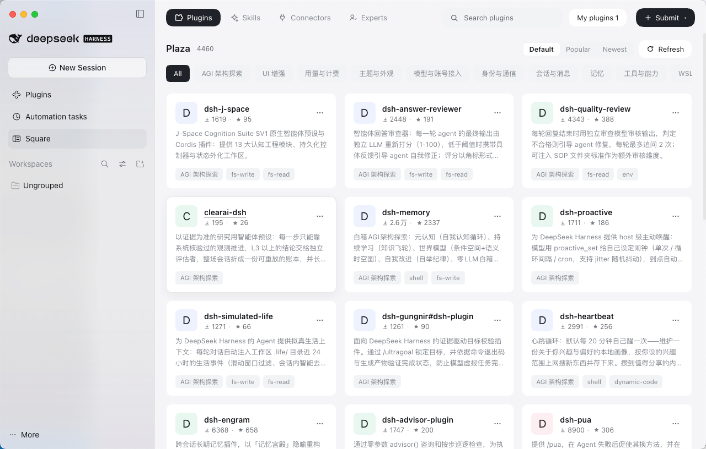

# dsh-squares

[English](README.md) | [**中文**](README.zh-CN.md)

DSH（DeepSeek Harness）的**一体化工作台插件**：在 Web GUI 侧边栏新增一个「广场（Square）」
全局面板，用同一个页面管理 **技能 Skill / 专家 Expert / 连接器 Connector（MCP）/ 插件 Plugin**。
**Web 端（`dsh web`）与桌面端（DeepSeek Harness.app）共用同一份代码与构建产物。**

侧边栏 →「广场」面板：四个页签默认展示广场（官方/社区目录），右上角「我的专家 / 我的技能 /
我的 MCP / 我的插件」进入子页面管理本地内容，子页面顶部「返回广场」回到广场。

## 1. 安装

已发布到 npm 与 GitHub：

```bash
dsh plugin --profile web add dsh-squares            # 从 npm 安装
dsh plugin --profile web add github:ai-tool-labs/dsh-squares   # 或 GitHub
# 桌面端：打开侧边栏「插件」面板 → 点击「添加插件」 → 输入框输入 "dsh-squares" → 点击安装
# 安装后重启 harness 生效（桌面端重启 App；Web 端重启 dsh web）
```

装好后侧边栏出现「广场」一行，点击即打开面板。

## 2. 截图

「广场」面板在 Web GUI 侧边栏中的效果图：



## 3. 开发

```bash
pnpm --filter dsh-squares typecheck    # 宿主 + 客户端两套 tsconfig
pnpm --filter dsh-squares build        # tsc(宿主) + tsc(客户端 .d.ts) + esbuild bundle
pnpm --filter dsh-squares smoke        # 宿主冒烟（真实 Cordis 生命周期 + 文件系统 + 路由）
pnpm --filter dsh-squares test:routes  # 路由集成（专家/连接器写路径）
pnpm --filter dsh-squares check:client # bundle 形态 / id / 外部依赖白名单 + 模拟 loader
```

### 从源码构建安装（开发者）

```bash
pnpm --filter dsh-squares build                                 # 构建（工作区先 pnpm install）
dsh plugin --profile web add /绝对路径/dsh-squares    # 2A) Web profile
# 2B) Desktop：profile 由 Electron 独占，手工写进清单再用 pnpm 建链
python3 - <<'PY'
import json, pathlib
p = pathlib.Path.home() / '.dsh/profiles/desktop/package.json'
d = json.loads(p.read_text())
d.setdefault('dependencies', {})['dsh-squares'] = 'link:/绝对路径/packages/dsh-squares'
bundles = d['dsh']['profile']['bundles']
if 'dsh-squares' not in bundles:
    bundles.append('dsh-squares')
p.write_text(json.dumps(d, indent=2) + '\n')
PY
cd ~/.dsh/profiles/desktop && CI=true pnpm install
# 3) 重启 harness（桌面端重开 App；Web 端重启 dsh web）
```
